# 课迹 第一版详细设计说明书（LLD）

| 项目 | 内容 |
| --- | --- |
| 文档版本 | 0.2 |
| 文档类型 | 详细设计说明书（Low Level Design，LLD） |
| 依据 | 《课迹 第一版需求分析书》v0.2、`docs/API_CONTRACT.md`、Android 端与服务端源码 |
| 适用范围 | 第一版（MVP）个人使用 |
| 运行边界 | Windows 开发机只构建 APK；落地运行只由 Android 手机与 Linux `server.example.com` 交换信息 |

本文档把项目拆成 Android 采集端模块、Linux 服务端模块、网络接口与持久化模块，并对每一个模块给出架构、工具、职责和数据传输路径。文中 Mermaid 图用于表达模块关系和运行时数据流。


## 1. 总体架构

### 1.1 运行拓扑

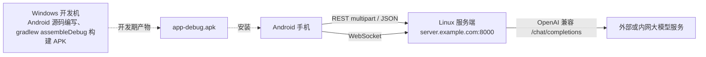

落地运行时只有 `Phone -> Server -> 外部 LLM` 方向和 `Server -> Phone` 方向的信息交换。Windows 开发机不提供任何在线接口。

### 1.2 分层架构

Android 端分为四层：

1. UI 层：Fragment、Adapter、自定义 Canvas 思维导图视图。
2. 状态层：`CaptureBus` 以 `StateFlow` 维护课堂实时状态。
3. 领域/仓库层：`CourseRepository` 负责课程结果读取、编辑、导出。
4. 基础设施层：`ApiClient`、`PendingUploadWorker`、`LocalCacheStore`、`AppPreferences`、`CaptureService` 和采集组件。

Linux 服务端分为四层：

1. 路由层：`app/api/routes.py` 暴露 REST 与 WebSocket。
2. 服务层：`app/services/sensevoice.py`、`ocr.py`、`llm.py`。
3. 持久化层：`app/db.py` 的 SQLAlchemy ORM 与 `data/` 文件目录。
4. 基础设施层：Uvicorn、systemd、FFmpeg、SenseVoice ONNX worker、PaddleOCR/OpenVINO、外部 LLM HTTP 客户端。

### 1.3 模块总览

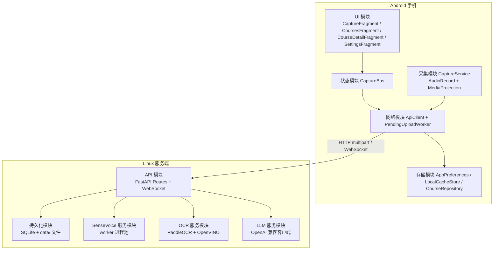

### 1.4 模块目录总览

| 子系统 | 模块 | 源码位置 | 职责与工具 |
| --- | --- | --- | --- |
| Android | 应用入口 | `app/src/main/java/com/keji/classroomnote/` | `MainActivity` 底栏导航、`CourseRepository.markStaleRecordingCoursesInterrupted` 启动清理 |
| Android | 采集模块 capture | `.../capture/CaptureService.kt`、`AudioDsp.kt`、`AacAdtsEncoder.kt`、`CaptureBus.kt` | 前台服务、AudioRecord、MediaProjection、AAC ADTS 编码、StateFlow 全局状态 |
| Android | 网络模块 net | `.../net/ApiClient.kt`、`Dto.kt`、`PendingUploadSync.kt`、`PendingUploadWorker.kt` | OkHttp、Kotlin Serialization、Basic 认证、multipart、WebSocket、WorkManager 补传 |
| Android | 存储模块 store | `.../store/AppPreferences.kt`、`LocalCacheStore.kt`、`CourseRepository.kt` | SharedPreferences、外部会话文件、课程 JSON 缓存、本地导出 |
| Android | UI 模块 ui | `.../ui/`、`.../ui/mindmap/` | Fragment、ViewBinding、RecyclerView、Canvas 思维导图 |
| 服务端 | 应用入口 | `server/app/main.py` | FastAPI 生命周期、建表、OCR 预热、服务关闭 |
| 服务端 | 路由层 | `server/app/api/routes.py` | REST、WebSocket、认证、上传、课后任务、广播 |
| 服务端 | 服务层 | `server/app/services/sensevoice.py`、`ocr.py`、`llm.py` | SenseVoice 转写、OCR 识别、LLM 生成 |
| 服务端 | 数据层 | `server/app/db.py`、`config.py`、`dependencies.py` | SQLAlchemy 2 async、SQLite、Pydantic Settings、密码哈希 |
| 服务端 | 部署与脚本 | `server/scripts/`、`server/deploy/` | 账号创建、迁移、测试、冒烟、systemd 服务 |

`server/app/services/` 与 Android 的 `net/` 是天然模块边界：手机端只有网络接口依赖，服务端内部算法不暴露给手机端。当前 Android `capture/` 与 `server/app/api/routes.py` 仍偏单体，建议按第 7 节的拆分实施。

---

## 2. Android 端模块设计

### 2.1 模块清单

| 模块 | 源码位置 | 职责 | 技术与架构 |
| --- | --- | --- | --- |
| 采集模块 capture | `app/src/main/java/com/keji/classroomnote/capture/` | 麦克风录音、DSP、AAC 分段、MediaProjection 截屏、JPEG 压缩 | Android `AudioRecord`、`MediaCodec`、`MediaProjection`、`ImageReader`、前台 Service、`HandlerThread` |
| 全局采集状态 CaptureBus | `capture/CaptureBus.kt` | 维护课堂开始/停止、字幕、时间轴、待上传数量、状态文本 | 单例 `object` + Kotlin `StateFlow` |
| 网络模块 net | `net/ApiClient.kt`、`Dto.kt` | REST/WebSocket 通信、Basic 认证、multipart 上传、DTO 编解码 | OkHttp 4、Kotlin Serialization、suspend/coroutine |
| 待上传模块 net | `net/PendingUploadWorker.kt`、`net/PendingUploadSync.kt` | 离线文件在 15 分钟周期内自动补传 | AndroidX WorkManager，`PeriodicWorkRequest` |
| 存储模块 store | `store/AppPreferences.kt`、`LocalCacheStore.kt`、`CourseRepository.kt` | 设置、会话文件、课程详情、本地缓存与导出 | `SharedPreferences`、应用私有目录 JSON 文件、文件命名规则 |
| UI 模块 | `ui/` | 底栏导航、课堂采集页、课程列表、详情、设置、思维导图编辑 | Fragment + ViewBinding + RecyclerView + 自绘 Canvas |

### 2.2 采集模块详细设计

#### 2.2.1 音频链路

1. `CaptureService` 在 `startAsForeground()` 中申请麦克风前台服务类型。
2. `AudioRecord` 以 16kHz、单声道、16bit PCM 采集。
3. `AudioDsp` 启用系统 `AEC/NS/AGC`，并在软件层做 RMS 电平检测、自动增益和静音阈值判断。
4. `AacAdtsEncoder` 使用硬件/系统 `MediaCodec` 将 PCM 编码为 AAC ADTS，32 kbps。
5. 编码文件命名规则为 `audio_%05d_%010d.aac`，其中第二位数字是 `offset_ms`。
6. 用 VAD 把连续语音识别成一个待发送语音段：达到 30 秒最大长度，或尾静音持续 1 秒后关闭分段。
7. 整段时长少于约 3 秒、或有效语音少于约 2 秒的片段直接丢弃，避免大量过短音频碎片被上传。

音频线程是一个独立 `Thread`，不阻塞 UI 线程。

#### 2.2.2 截屏链路

1. `MediaProjectionManager.createScreenCaptureIntent()` 获取投影授权。
2. `VirtualDisplay` 输出到 `ImageReader`，帧率由系统通知驱动。
3. 按 `AppPreferences.screenIntervalSec` 过滤，默认 2 秒。
4. RGBA 帧转为 Bitmap，最长边限制为 1600px，JPEG 质量 68。
5. 与最近已保存帧比较，画面完全不变时跳过。
6. 画面变化后保持约 1.5 秒稳定才提交该帧；动画、光标或瞬态变化期间只更新“待提交帧”，不立即产生文件。
7. 只有稳定后的唯一一帧被命名为 `screen_%03d_%010d.jpg` 写入本地排队上传。

#### 2.2.3 上传循环

`CaptureService.uploadLoop()` 每 2 秒扫描 `sessions/<course_id>/`：

- 跳过正在写入的 `activeAudioFile`。
- 优先按文件名升序上传，保证 `offset_ms` 顺序稳定。
- 上传成功后删除文件；删除失败改为 `.done` 后缀占位。
- 上传失败时调用 `LocalCacheStore.enforceQuota()`，避免无限占用。

#### 2.2.4 WebSocket 接收

`startWebSocketLoop()` 对 `WS /api/v1/courses/{course_id}/stream` 做指数退避重连：

- 连接成功清空重试计数。
- 收到 `subtitle` 时，`confirmed=true` 写入 `CaptureBus.addConfirmedSubtitle()`。
- 收到 `timeline` 时写入 `CaptureBus.addTimeline()`。
- 收到 `status` 时更新状态栏。

### 2.3 网络模块详细设计

`ApiClient` 使用 OkHttp：

- 认证：`Authorization: Basic base64(username:password)`。
- 普通 JSON 接口：POST/PUT + `Content-Type: application/json`。
- 音频/截图上传：`multipart/form-data`，字段 `offset_ms`、`realtime`、`file`。
- 长音频导入：`uploadAudioStream()` 从 ContentResolver 流式写入，避免整文件载入内存。

`ApiClient` 提供这些业务方法：

| 方法 | 对应接口 | 数据类型 |
| --- | --- | --- |
| `startCourse()` | `POST /api/v1/courses` | JSON |
| `uploadAudio()` | `POST /api/v1/courses/{id}/audio` | multipart |
| `uploadAudioStream()` | 同上 | multipart 流 |
| `uploadScreen()` | `POST /api/v1/courses/{id}/screens` | multipart |
| `finishCourse()` | `POST /api/v1/courses/{id}/finish` | JSON |
| `interruptCourse()` | `POST /api/v1/courses/{id}/interrupt` | JSON |
| `generate()` | `POST /api/v1/courses/{id}/generate` | JSON |
| `listCourses()` | `GET /api/v1/courses` | JSON 数组 |
| `getCourse()` | `GET /api/v1/courses/{id}` | JSON |
| `updateCourse()` | `PUT /api/v1/courses/{id}/content` | JSON |
| `changePassword()` | `POST /api/v1/me/password` | JSON |
| `connectWebSocket()` | `WS /api/v1/courses/{id}/stream` | WebSocket JSON 事件 |

DTO 全部定义在 `net/Dto.kt`，字段使用 `@SerialName` 与服务端保持一致：

- `SubtitleLine`：`id/start_ms/end_ms/text/original_text/speaker/page/page_title/confirmed/confidence/review_state`
- `CourseDetail`：`courseId/title/status/createdAt/durationMs/summary/transcript/timeline/sections/mindmap`
- `WebSocketEvent`：`type/subtitle/timeline/message/status`

### 2.4 存储模块详细设计

| 存储 | 位置 | 用途 | 关键技术 |
| --- | --- | --- | --- |
| 配置 | `app/src/main/java/../store/AppPreferences.kt` | 服务地址、用户名密码、截屏间隔、本地配额、LLM 配置 | `SharedPreferences` |
| 离线会话文件 | `getExternalFilesDir(null)/sessions/<course_id>/` | 未上传的 `.aac`/`.jpg` 文件 | 文件系统 + 文件名编码 `offset_ms` |
| 课程详情缓存 | `filesDir/courses/*.json` | 服务器不可达时课程列表/详情降级展示 | `CourseRepository` + Kotlin Serialization |
| 导出 | 系统 `SAF` 保存的文件 | Markdown/OPML | `ActivityResultContracts.CreateDocument` |

`LocalCacheStore.enforceQuota()` 默认配额为 500 MB；配额不足时按文件修改时间删除最早的上传文件，但始终保护正在写入的 `activeAudioFile`。

### 2.5 UI 模块详细设计

| Fragment | 数据来源 | 动作 |
| --- | --- | --- |
| `CaptureFragment` | 采集页 + `CaptureBus.uiState` | 开始/停止课程权限与投影授权、实时字幕列表、导入音频 |
| `CoursesFragment` | `CourseRepository.courses()` | 课程列表，搜索 |
| `CourseDetailFragment` | `CourseRepository.course()` | 刷新/生成/编辑总结/编辑小节/编辑思维导图/导出 |
| `SettingsFragment` | `AppPreferences` | 服务器地址、账号、截屏开关、麦克风、截屏间隔、LLM 参数、修改密码 |
| `MindMapView` | 自绘 Canvas | 树状结构绘制、节点选择、拖拽换位、增删改 |

---

## 3. Linux 服务端模块设计

### 3.1 模块清单

| 模块 | 源码位置 | 职责 | 架构与工具 |
| --- | --- | --- | --- |
| API 路由 | `server/app/api/routes.py` | REST + WebSocket、认证、上传、任务触发、状态广播 | FastAPI、BackgroundTasks、WebSocket、Pydantic settings |
| 数据持久化 | `server/app/db.py` | 用户、课程、音频段、截图、时间轴、任务 | SQLAlchemy 2 Async、aiosqlite、SQLite |
| 配置 | `server/app/config.py` | `.env` 注入 | Pydantic Settings 2 |
| 转写服务 | `server/app/services/sensevoice.py` | 实时转写、课后分批转写 | asyncio subprocess + JSON-RPC over stdin/stdout、FFmpeg |
| 转写 worker | `server/scripts/sensevoice_worker.py` | 常驻子进程加载 ONNX 模型并推理 | `funasr_onnx`、`SenseVoiceSmall`、`ct-punc`、ONNX Runtime CPU |
| OCR 服务 | `server/app/services/ocr.py` | PaddleOCR/OpenVINO 识别、页码/标题提取 | PaddleOCR 3.7、PaddleX HPI、OpenVINO、`asyncio.run_in_threadpool` |
| LLM 服务 | `server/app/services/llm.py` | OpenAI 兼容接口、JSON 校验、重试 | `httpx.AsyncClient`、OpenAI 兼容 `/chat/completions` |
| 转写校正服务 | `server/app/services/correction.py` | 按时间窗对齐 ASR 与 OCR，由 LLM 校正转写 | `asyncio`、OpenAI 兼容接口、`review_state` 标记 |
| 部署 | `server/deploy/keji-backend.service` | systemd 常驻 | systemd + uvicorn |
| 运维脚本 | `server/scripts/*.py` | 创建账号、测试、冒烟、迁移 | Python |

### 3.2 API 管理模块

FastAPI 在启动 `lifespan` 时：

1. `Base.metadata.create_all()` 创建所有表。
2. `asyncio.create_task(warmup_ocr())` 预热 OCR 模型。
3. 关闭时取消预热任务并关闭 SenseVoice 子进程池。

`router` 上挂 `Depends(require_auth)`，所有 REST 都需要 Basic 认证；WebSocket 单独使用查询参数认证并返回 `4401` 关闭码。

### 3.3 SenseVoice 转写模块

#### 3.3.1 架构

SenseVoice 被设计为常驻子进程池：

- `SenseVoiceService` 启动 N 个 `_SenseVoiceWorker`。
- 每个 worker 通过 `stdin/stdout` 持续读取 JSON 行（JSON-RPC 风格）请求，不重复加载模型。
- worker 使用 `SenseVoiceSmall(model_dir, batch_size=1, quantize=True, intra_op_num_threads=threads)` 加载 ONNX 量化模型，另加载 `ct-punc` 标点模型。
- 解析：`asyncio.Lock` 串行化每个 worker 请求。
- 配置：`KEJI_SENSEVOICE_WORKERS=2`、`KEJI_SENSEVOICE_THREADS=8`。
- 请求帧：

```json
{"type":"transcribe","wav":"/tmp/xx.wav","request_id":"uuid"}
```

响应帧：

```json
{"ok":true,"request_id":"uuid","text":"转写文本"}
```

#### 3.3.2 实时转写

`transcribe_segment()` 流程：

1. `_convert_to_wav()`：FFmpeg 转成 16 kHz 单声道 PCM WAV。
2. 从 worker 池中轮询一个空闲 worker。
3. 调用 worker 转写。
4. 返回带 `start_ms/end_ms/text/confirmed=true/page/page_title/review_state` 的字幕。

#### 3.3.3 课后重转写

`transcribe_merged()` 流程：

1. 把所有 `AudioSegment` 按 `offset_ms` 分别转 WAV。
2. 按时间覆盖写入同一段 PCM WAV。
3. 使用 30 秒窗口、2 秒重叠切分。
4. 用信号量限制并发，交给 worker 池并行转写。
5. `_merge_chunk_results()` 用相似度和时间窗去重。

### 3.4 OCR 模块

#### 3.4.1 架构

- `settings.KEJI_OCR_ENABLE_HPI=true` 时走 PaddleX HPI + OpenVINO。
- `KEJI_OCR_MODEL=PP-OCRv6_medium`。
- `_run_ocr()` 是同步推理函数，由 `recognize_image()` 用 `run_in_threadpool()` 执行，不占用事件循环。
- `warmup_ocr()` 在进程启动时初始化模型，避免第一张图触发冷启动。

#### 3.4.2 输出结构

```json
{
  "page": 5,
  "title": "卷积神经网络",
  "content_hash": "sha256 前 16 位",
  "lines": ["第5页", "卷积神经网络", "..."],
  "scores": [0.98, 0.96],
  "boxes": [[x1,y1,x2,y2]],
  "body": "全部识别文本"
}
```

`_ocr_terms()` 从 `lines` 提取术语，`_ocr_correct_text()` 在实时字幕返回前做基础替换；LLM 生成阶段再把完整 OCR 证据作为 prompt 上下文。

### 3.5 LLM 生成模块

`chat_json()` 以 OpenAI 兼容接口调用：

```text
POST {base_url}/chat/completions
Authorization: Bearer {api_key}
Content-Type: application/json
```

生成任务调用 `run_generation()`，它会：

1. 从数据库读 `transcript`、`screenshots`、`audio_segments.draft_text`。
2. 先调用 `correction.correct_transcript()`，按 `start_ms` 对齐同一时间窗的 OCR 证据，由 LLM 校正转写并写回 `Course.transcript`。
3. 再组装 `evidence` 字典：校正后转写、OCR 页码/标题/正文、截图。
4. 要求 LLM 返回确定 JSON：`summary`、`sections`、`mindmap`。
5. 429 重试最多 10 次、每次等待 10 秒；普通 HTTP/JSON 错误重试 3 次，指数退避。
6. 校验 `sections` 结构后写入 `Course.summary/sections/mindmap`。

### 3.6 LLM 转写校正模块

`server/app/services/correction.py` 是“OCR 证据 → LLM 校正转写”的独立模块，不把校正逻辑混入路由层：

- 输入：`transcript` 行数组、按 `offset_ms` 排序的 `screenshots`、课程级 `LlmSettings`。
- 对齐：取 `offset_ms <= start_ms` 的最新一张 OCR 截图；录音开始前没有截图时，可回退到前 30 秒内的第一张截图。
- 批量：每批最多 20 行或约 3000 字，避免长课程一次把全部转写塞进一个 prompt。
- 规则：LLM 只能依据同窗 OCR 页码/标题/正文修正同音字、专有名词、数字和术语；证据不足时原样保留，不得编造。
- 输出：在行对象中增加 `original_text`，改写 `text`，并标记 `review_state=llm_corrected`。
- 失败：无 OCR、LLM 未配置或校正调用失败时保留原 `transcript`，不阻塞生成，并在服务端日志中记录原因。
- 429 重试规则与 LLM 生成一致：最多 10 次、间隔 10 秒；普通错误最多 3 次、指数退避。

手机端不参与校正：`SubtitleLine.text` 始终是最终展示文本，`original_text` 仅在需要展示“已修正”时使用。

### 3.7 数据持久化模块

#### 3.7.1 数据库表

| 表 | 主键 | 关键字段 | 作用 |
| --- | --- | --- | --- |
| `users` | `id` | `username`、`password_hash`、`password_salt`、`created_at` | 账号；用户名唯一，密码 PBKDF2-SHA256 |
| `courses` | `id` | `title`、`created_at`、`duration_ms`、`status`、`last_activity_at`、`llm_base_url`、`llm_api_key`、`llm_model`、`summary`、`transcript`、`sections`、`mindmap` | 课程主键由 Android 生成，存储生成结果 |
| `audio_segments` | `id` | `course_id`、`sequence`、`offset_ms`、`filename`、`content_type`、`size_bytes`、`draft_text`、`draft_confidence`、`review_state`、`created_at` | 音频分段文件与上传时间轴 |
| `screenshots` | `id` | `course_id`、`offset_ms`、`filename`、`content_type`、`size_bytes`、`page`、`title`、`content_hash`、`ocr_json`、`ocr_status`、`created_at` | 截图文件与 OCR 结果 |
| `timeline_events` | `id` | `course_id`、`offset_ms`、`page`、`title`、`content_hash` | 页码/标题时间轴事件 |
| `jobs` | `id` | `course_id`、`task_type`、`status`、`message`、`result`、`created_at`、`updated_at` | 课后重转写与生成任务 |

写入/读取由 SQLAlchemy 异步会话完成；所有时间字段以毫秒时间戳存储。二进制文件：

```text
data/
  keji.db
  audio/<course_id>/xx.aac|mp3|m4a
  screens/<course_id>/xx.jpg
```

---

## 4. 数据流图

### 4.1 课堂实时数据流总览

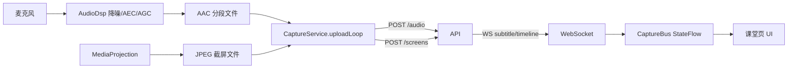

### 4.2 实时字幕数据流

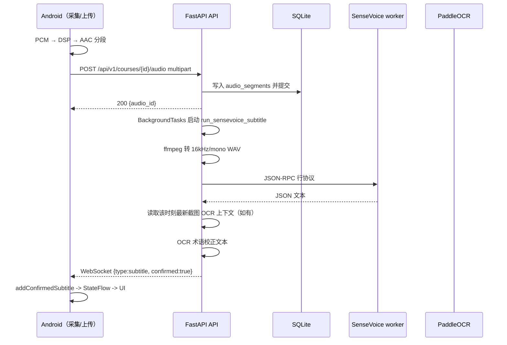

### 4.3 截屏 OCR 数据流

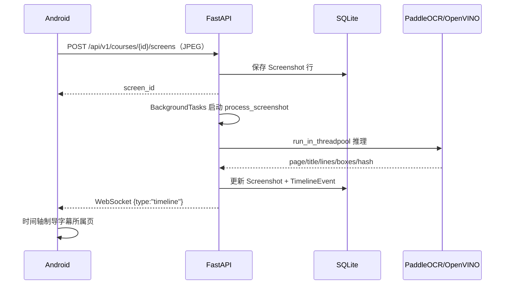

### 4.4 离线补传数据流

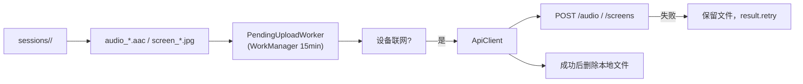

### 4.5 课后重转写数据流

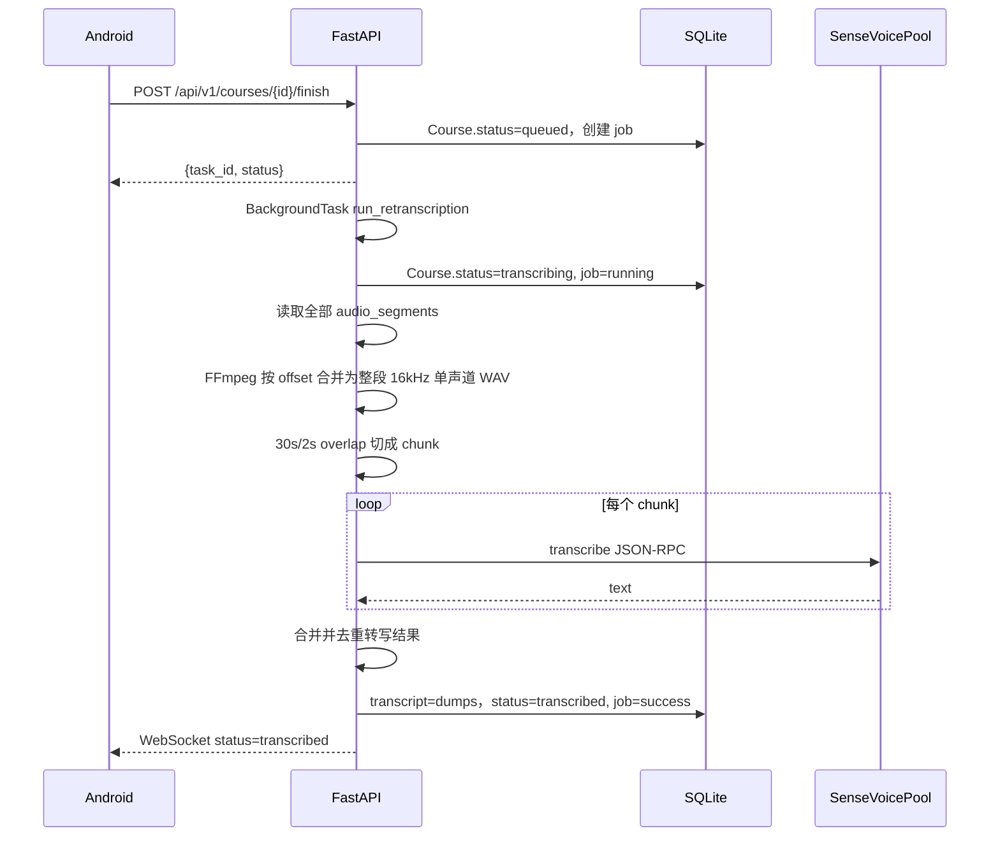

### 4.6 音频导入数据流

App 选择外部文件后创建一门独立课程，整段以 `offset_ms=0` 流式上传，再提交课后转写；`realtime` 不传，避免触发课堂实时字幕通道。

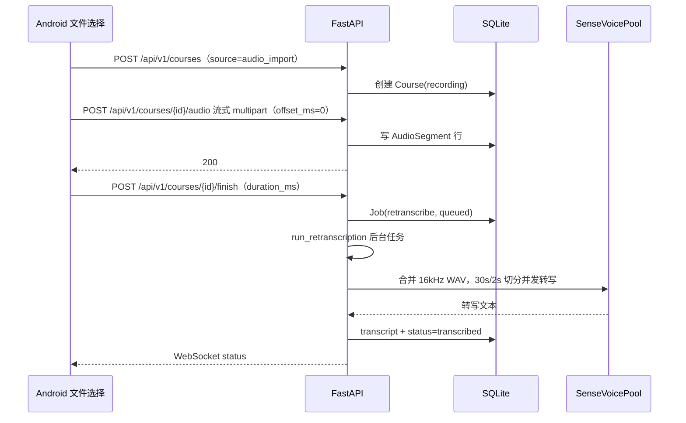

### 4.7 LLM 生成数据流

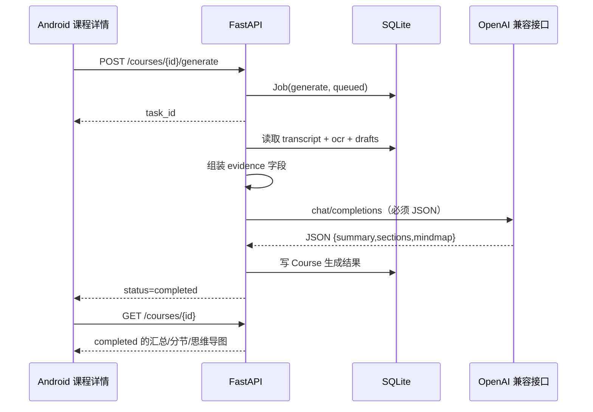

### 4.8 并行识别与 LLM 校正数据流

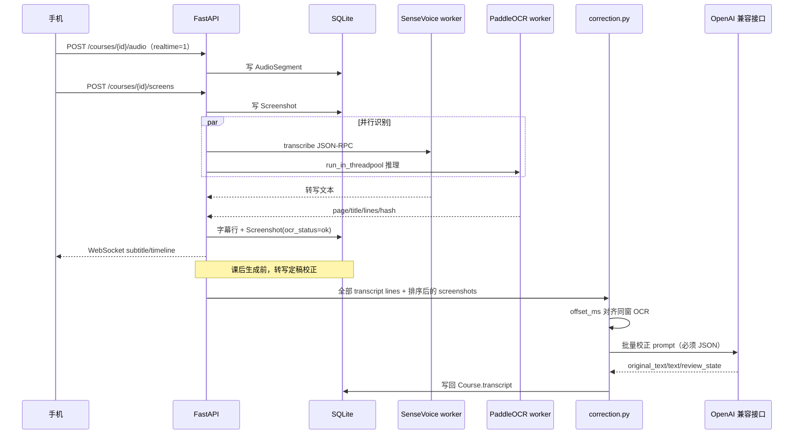

### 4.9 状态机

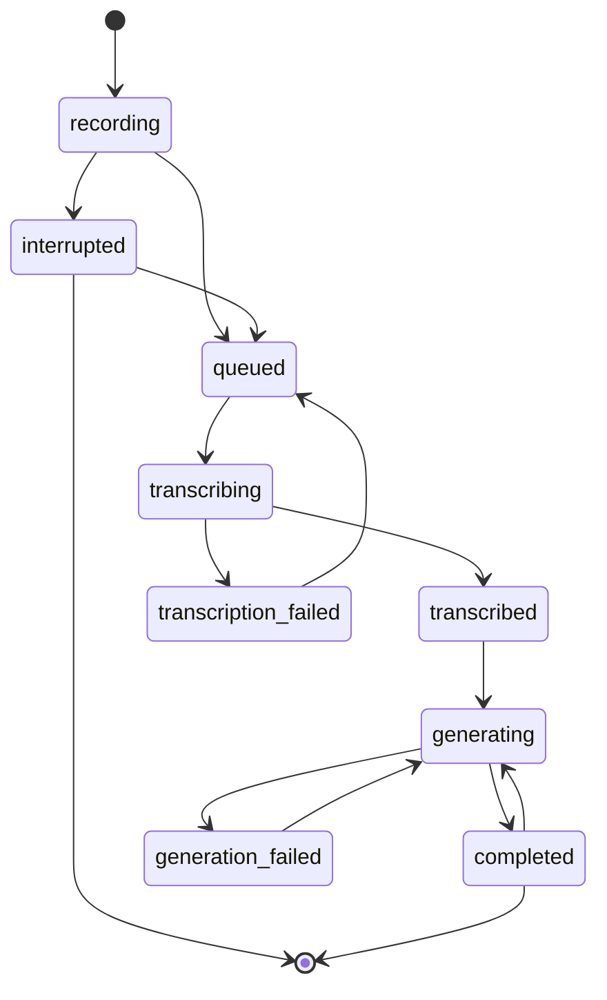

---

## 5. 接口与传输设计

### 5.1 网络接口

| 传输协议 | 用途 |
| --- | --- |
| HTTP/1.1 | JSON 与 multipart，普通上传和课程管理 |
| WebSocket | 实时字幕、时间轴、任务状态 |
| subprocess stdin/stdout | FastAPI 与 SenseVoice worker 的内部 JSON-RPC |
| 外部 HTTP | LLM 的 `/chat/completions` |

### 5.2 认证与敏感信息

- REST：每个请求带 `Authorization: Basic`。
- WebSocket：使用查询参数用户名/密码，服务端返回 `4401` 拒绝。
- 密码使用 PBKDF2-SHA256 加盐存储。
- LLM API Key 由 App 设置页传递给课程，但服务端接口不暴露回 App；App 设置里的密钥不参与导出。

### 5.3 幂等与一致性

- 手机生成 `course_id`，服务端使用该 ID 作为主键。
- 重复上传可在 `audio/screens` 下产生重复行；当前通过文件名 `offset_ms` 和顺序排序应对。
- `offset_ms` 是手机-服务端对齐的唯一时间轴。
- 只有服务端 `confirmed=true` 的字幕进入最终字幕。

### 5.4 LLM 校正字段约定

- `text` 始终是手机端最终展示的转写文本。
- `original_text` 是校正前的文本，仅在转写被 LLM 改写时出现。
- `review_state=llm_corrected` 表示该行已经由服务端 LLM 使用同窗 OCR 证据校正。
- 校正不影响 `start_ms/end_ms/id`，不改变字幕时间轴。
- 手机端收到未知或可选字段必须忽略，不因不存在 `original_text` 而失败。

---

## 6. 并发与性能设计

| 位置 | 并发策略 |
| --- | --- |
| Android UI | 主线程只更新界面；网络/编码在工作线程或 `Dispatchers.IO` |
| Android 音频线程 | 独立 Java `Thread`，不阻塞 UI |
| Android 截屏线程 | `HandlerThread` 处理 `ImageReader`，按截屏间隔过滤 |
| Android 上传 | `uploadLoop()` 每 2 秒扫描一次，串行上传 |
| 服务端 API | FastAPI 异步事件循环；阻塞 IO 使用 `run_in_threadpool` |
| 服务端 OCR | 单实例 + `run_in_threadpool` 线程池，`KEJI_OCR_CPU_THREADS=2` |
| 服务端 SenseVoice | 常驻 worker 数量由 `.env` 控制；并发用 `Semaphore(workers)`，每 worker 内部 `intra_op_num_threads=8` |
| 服务端 LLM | 后台 asyncio 任务；429 最多 10 次、间隔 10 秒，其他异常最多 3 次指数退避 |

当前服务端任务调度使用 `BackgroundTasks` 与 `asyncio.Task` 集合，未引入外部队列；因此进程重启后会丢失未完成的任务。该限制已写入风险评估，未来可用持久化队列替换。

---

## 7. 模块化重构建议

当前代码已经按 Android 包和服务端子模块初步划分，但仍可进一步拆细：

### 7.1 服务端路由最小化

建议把 `server/app/api/routes.py` 拆为：

```text
server/app/api/
  __init__.py
  health.py
  auth.py
  courses.py
  audio.py
  screens.py
  tasks.py
  export.py
  stream.py
```

每个子路由保持 100-300 行，职责包括：请求解析、写入、状态广播，算法不进入路由层。

### 7.2 Android 采集模块拆分

`CaptureService.kt` 目前同时承担前台服务、录音、截屏、上传、接收编排。建议拆为：

```text
capture/
  CaptureService.kt        # 前台服务与生命周期
  AudioCaptureEngine.kt    # 朗读采样/编码
  ScreenCaptureEngine.kt   # 投影/截屏/编码
  UploadEngine.kt          # 会话文件与上传循环
  WebSocketEngine.kt       # WS 连接与重试
```

这样后续可以单测 `AudioEngine` / `UploadEngine`，也避免多个线程在同一个大 Service 类中交叉。

---

## 8. 容错与边界

| 场景 | 处理 |
| --- | --- |
| 服务器不可达 | 手机继续录音/截屏，文件留在 `sessions/`，`PendingUploadSync` 补传 |
| 上传失败 | `uploadLoop` 下一个周期重试 |
| 本地超过了 500MB | 优先删除已成功上传的最早文件 |
| 截屏为空 | 不写入 `screen_` 文件 |
| OCR 失败 | 保存 `ocr_status=failed` 与原图，不阻塞课堂 |
| SenseVoice 不可用 | 实时字幕不推送，课后转写失败，任务状态可感知 |
| LLM 429 | 重试 10 次、间隔 10 秒 |
| LLM JSON 非法 | 服务端校验失败后重试，最多 3 次 |
| 课程中途崩溃 | App 启动或课程列表加载时扫描超过 3 分钟无活动的 `recording` 课程，标记 `interrupted` |

---

## 9. 安全与隐私

- 手机端不包含任何模型文件和本地识别组件。
- 音频/截图只上传到 Linux 服务端，只有转写文本、OCR 文本和 prompt 会离开局域网调用外部 LLM。
- `.env` 不进入 APK，`llm_api_key` 不出现在详情接口。
- App 使用 `usesCleartextTraffic=true` 支持局域网 HTTP，建议对外访问始终使用 HTTPS。

---

## 10. 交付与验证

LLD 中的每一条数据流都应通过下列测试门禁：

1. `gradlew assembleDebug` 在 Windows 构建成功。
2. 手机仅连接 `server.example.com:8000` 时能完成录音、截图、字幕、时间轴闭环。
3. `smoke_api.py` 验证课程与音频上传，`smoke_realtime_subtitle.py` 验证实时确认字幕，`smoke_sense_merged.py` 验证整段合并转写。
4. `eval_cer.py` 在服务器标准转写上执行 5 分钟和 1 小时存档测试。
5. OCR 用服务器已截图验证 `ocr_status=ok` 与页码/标题命中。
6. 长课后转写（≥1h）验证 30 秒并发切分合并后时间轴正确。
7. LLM 生成任务在 429 时能自动重试并最终结束。
